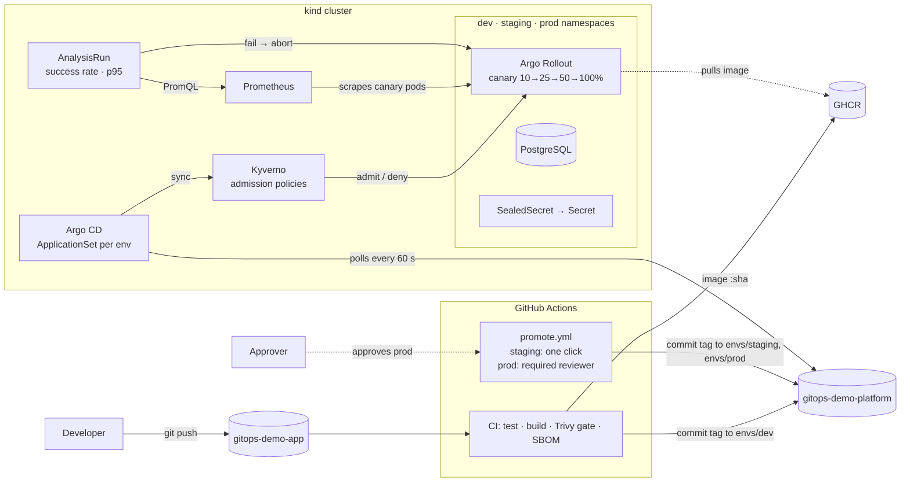

# gitops-demo-platform

[](https://github.com/KulmeetSJ/gitops-demo-platform/actions/workflows/ci.yml)

The GitOps side of the delivery platform for [gitops-demo-app](https://github.com/KulmeetSJ/gitops-demo-app):
a local Kubernetes cluster where **Git is the only way anything reaches the cluster**. Releases go dev → staging → prod
behind a human approval. Each release goes out as a canary that is judged on live metrics and rolled back without a human.
Non-compliant workloads are rejected at admission.

> All data is synthetic. Every number in [RESULTS.md](RESULTS.md) is a personal-project benchmark on a laptop kind cluster.

## Architecture



CI never holds cluster credentials. Its only write access is a deploy key that lets it commit to this repo.

## Results at a glance
Personal-project benchmarks; methods and raw data in [RESULTS.md](RESULTS.md) and [`measurements/`](measurements/).

| What | Median | Runs |
|---|---|---|
| Commit → healthy in **prod** (dev → staging → prod, canary at each), excluding human approval wait | **17m12s** (range 16m00s–18m40s) | 3 |
| Commit → healthy in **dev** (CI + GitOps commit + Argo CD sync + full canary) | **7m51s** | 3 |
| Bad release: first failed analysis → canary removed, stable serving 100% | **30 s** (every run) | 5 |
| Bad release: time the bad version served traffic | **90 s** | 5 |
| Bad release: push → automatically restored, no human action | **3m04s** (range 2m21s–3m42s) | 5 |
| Non-compliant manifests blocked at admission | **7/7** (0/1 compliant blocked) | n/a |

<!-- DEMO-GIF: add docs/demo.gif here (bad release → canary aborted) -->

## Quick start
Requires Docker (~8 GB of memory for Docker Desktop), `kind`, `kubectl`, `helm`, `kubeseal`.
```bash
make up        # kind cluster + Argo CD; Argo CD installs everything else from argocd/apps/
make status    # applications and pods per environment
make down      # delete the cluster (the Sealed Secrets key backup is kept)
```
UIs (port-forward, no ingress; see ADR 0002):
```bash
kubectl -n argocd port-forward svc/argocd-server 8080:80              # Argo CD (admin / see `make up` output)
kubectl -n argo-rollouts port-forward svc/argo-rollouts-dashboard 3100:3100
kubectl -n monitoring port-forward svc/kube-prometheus-stack-prometheus 9090
```

## How a release flows
1. A green build on `main` in the app repo pushes `ghcr.io/kulmeetsj/gitops-demo-app:<sha>` and commits that SHA to `envs/dev/values.yaml`.
2. Argo CD syncs dev. Argo Rollouts starts a **canary**. A background `AnalysisRun` checks the canary pods'
   **success rate (≥ 99%)** and **p95 latency (≤ 500 ms)** every 30 s. Two failed checks **abort** the rollout,
   and all traffic returns to the stable pods with no human involved.
3. **Actions → promote → staging** copies dev's tag into staging, which goes through the same canary.
4. **Actions → promote → prod** waits for a required reviewer on the `production` GitHub Environment, then copies staging's tag.
5. Kyverno checks every pod spec at admission: no `:latest` or untagged images, requests and limits required,
   no privileged containers or hostPath volumes, must run as non-root.

There is no `kubectl apply` in any pipeline. Manual changes to the cluster are reverted by Argo CD self-heal.

## Measuring it yourself
| Script | What it measures |
|---|---|
| `scripts/measure_lead_time.sh <app-sha> --promote` | Push → CI green → dev / staging / prod `Healthy`; human approval wait reported separately |
| `scripts/measure_rollback.sh [runs] [fault_rate]` | Ships a bad release (`FAULT_RATE`) through Git N times; times detection → rollback; reverts each one |
| `scripts/policy_report.sh` | Server-side dry run of the policy test corpus and the real chart; Kyverno background-scan totals |

## Layout
| Path | What it is |
|---|---|
| `bootstrap/` | kind config, Argo CD values, `up.sh` (the only imperative step) |
| `argocd/root.yaml` | App of apps → `argocd/apps/` |
| `argocd/apps/` | Platform components (pinned chart versions) + the app's `ApplicationSet` |
| `charts/gitops-demo-app/` | `Rollout`, `AnalysisTemplate`, `ServiceMonitor`, load generator, per-env PostgreSQL |
| `envs/<env>/values.yaml` | Image tag and sizing per environment. **Promotion = changing this file.** |
| `envs/<env>/secrets/` | `SealedSecret`s (encrypted; safe to commit) |
| `policies/kyverno/` | CEL `ValidatingPolicy`s, enforced in dev/staging/prod |
| `policy-tests/` | `kyverno test` suite run in CI, plus the manifests used by `policy_report.sh` |
| `scripts/` | Promotion, secret sealing, measurement scripts |
| `measurements/` | Raw CSVs written by the measurement scripts |
| `.github/workflows/` | `ci.yml` (helm lint, policy tests), `promote.yml` (environment promotions) |

## Design decisions
| ADR | Decision |
|---|---|
| [0001](docs/adr/0001-pull-based-gitops.md) | Pull-based GitOps; CI writes only to Git |
| [0002](docs/adr/0002-no-ingress-controller.md) | No ingress controller locally (ingress-nginx is archived); port-forward |
| [0003](docs/adr/0003-sealed-secrets-key-backup.md) | Sealed Secrets, with the controller key backed up outside the cluster |
| [0004](docs/adr/0004-canary-with-metric-analysis.md) | Canary with background metric analysis, scoped to canary pods |
| [0005](docs/adr/0005-admission-policy-kyverno-cel.md) | Kyverno CEL `ValidatingPolicy` for admission control |
